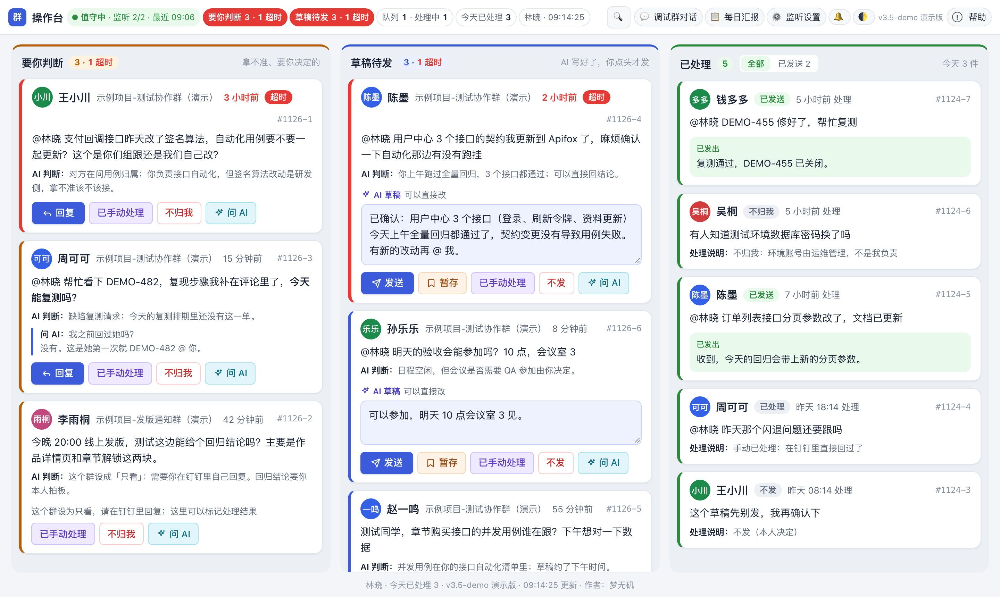
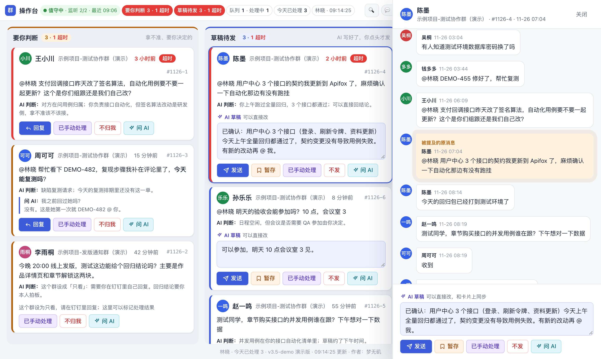
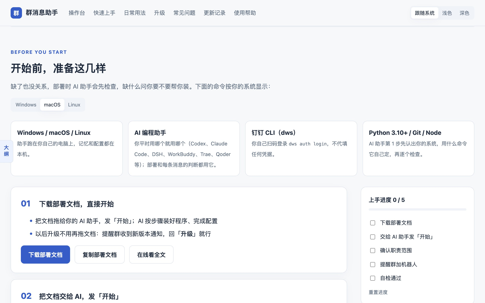

# 群消息助手（钉钉）

 

监听钉钉群消息，按你的角色和职责范围判断每一条：能答的写好回复，拿不准的交给你，不归你的不插话。后台运行，默认打开本机操作台，提醒走你自己的提醒群机器人。

- **任意 AI 编程助手**：Codex、Claude Code、DSH、WorkBuddy、Trae、Qoder 等，你平时用哪个就用哪个（账号、API Key 自己配）
- **Windows / macOS / Linux**：开机自启分别用计划任务 / LaunchAgent / systemd
- **本人确认后发送**：所有回复先写草稿，你确认后才发；绝不替你接需求、排期、承诺；别人之间的对话不插话
- **全角色**：内置角色职责库（产品、研发各端、测试、运营、后台、项目负责人），也能接你们自己的项目协作库

当前版本 **v3.5**（2026-11-26）。公共版本只包含通用程序和规则模板；个人账号、群、时段、配置、记忆、草稿和留痕都只在你自己电脑上。

## 怎么用

打开[在线指南](https://lvan826199.github.io/dingtalk-group-assistant/)，下载部署文档，拖进你的 AI 助手发「开始」：AI 按步骤装好程序，再和你确认角色、职责范围、要监听的群和提醒群机器人。

已经装过的：提醒群收到新版本通知后回「升级」即可；配置、记忆、草稿和本人规则都保留，升级包校验不通过就不替换。

## 操作台

助手在你电脑上开一个只有你能打开的网页：要你判断、草稿待发、已处理三栏一目了然，卡片左边色条分类型（橙=要你判断、蓝=草稿、绿=已处理、红=超时）。点卡片在右侧打开原会话并高亮那条消息，草稿就在卡片里改；按钮有发送、暂存、已手动处理、不发 / 不归我、问 AI。和提醒群双向同步——在哪边处理，另一边都跟着更新。

- **调试群对话**：在页面上直接和提醒群里的助手对话
- **每日汇报**：和提醒群每天收到的汇报是同一份
- **已处理自动关闭**：在原会话引用回复，或回复里写上同一个单号，那件事自动移到「已处理」
- **帮助**：顶栏最右边「帮助」打开使用帮助页（操作台怎么用、名词、提醒群指令、常见问题）

## 指南网页

部署文档可以一键生成网页（`python3 site/build_site.py`），在浏览器里看步骤、复制命令、下载文档：

| 上手步骤 + 进度勾选 | 日常用法（点指令就复制） |
|---|---|
|  |  |
| **深色模式** | **手机** |
|  |  |

## 目录

| 路径 | 内容 |
|---|---|
| `docs/` | 部署文档（给 AI 助手的完整指令、代码、工作手册） |
| `agent.py` | 助手主程序 |
| `bootstrap_memory.py` | 首次建记忆（读群历史和你的 AI 对话记录） |
| `roles/角色职责库.json` | 角色职责库，可以自己增删改 |
| `site/` | 可选：把文档做成内网网页（`python3 site/build_site.py`） |
| `CHANGELOG.md` | 更新记录 |
| `ROADMAP.md` | 路线图（待验证、计划中） |
| `tests/` | 自动化测试，CI 在 Windows / macOS / Linux 上跑 |

改完程序后运行 `python3 -I build_docs.py --docs-only`，只同步仓库文档；正式站点、共享盘部署单独确认。公开版只从内部仓库经导出脚本生成，敏感扫描必须为0，测试以本公开仓库的三平台 CI 为准。

## 前提

- 钉钉 CLI（`dws`），由你自己扫码登录；本工具不代填任何凭据
- Python 3.10+、Git、Node
- 一个只有你自己的钉钉群 + 自定义机器人（加签），用来接收提醒

## 许可

[Apache-2.0](LICENSE) · 作者：梦无矶
