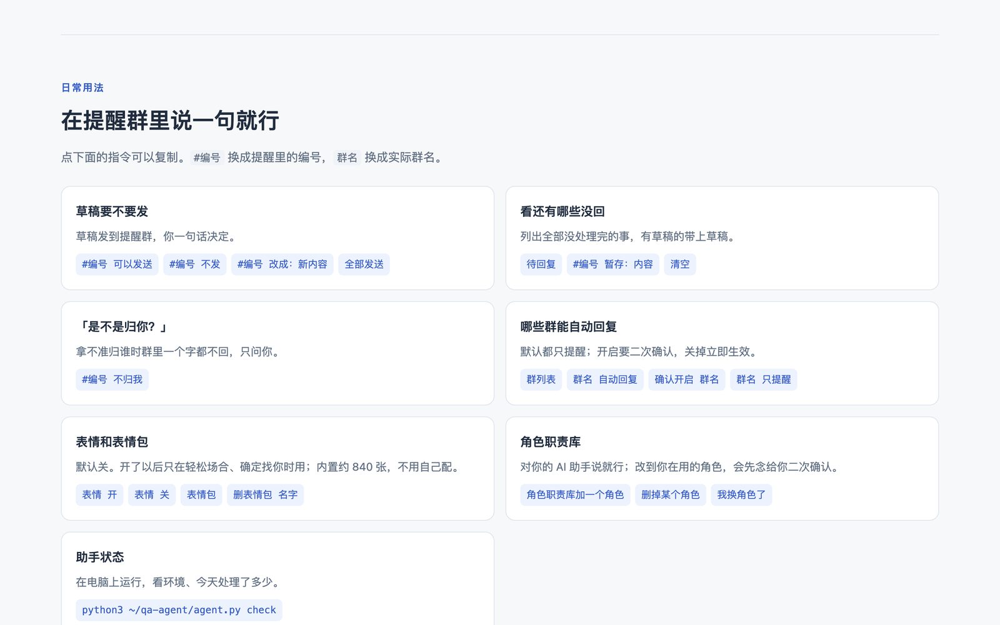
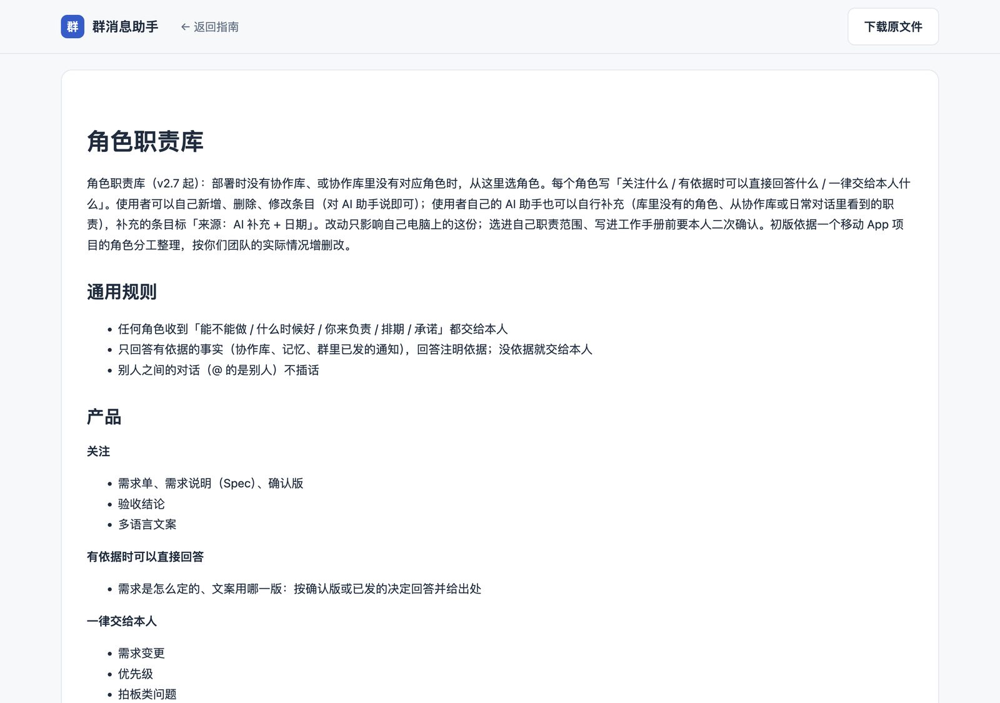
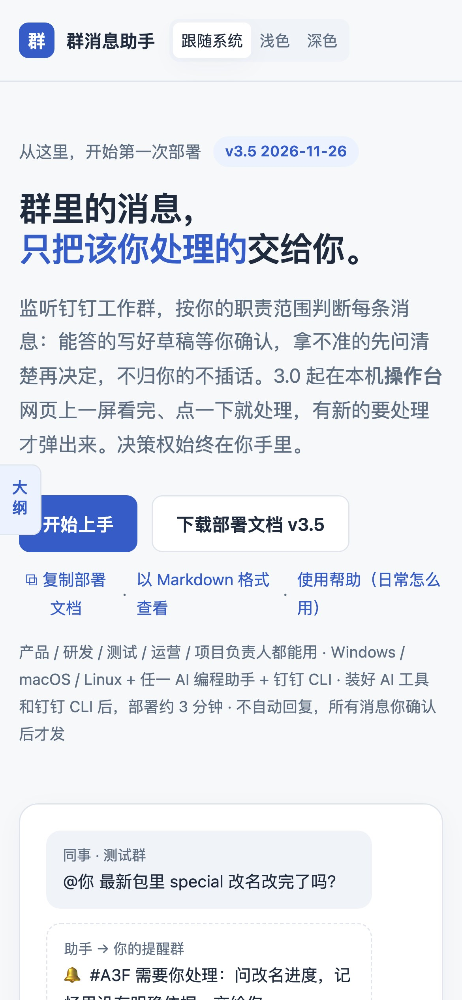

# 群消息助手（钉钉）

 

监听钉钉群消息，按你的角色和职责范围判断每一条：能答的写好回复，拿不准的交给你，不归你的不插话。全程后台静默，提醒只走你自己的提醒群机器人。

- **任意 AI 编程助手**：Codex、Claude Code、DSH、WorkBuddy、Trae、Qoder 等，你平时用哪个就用哪个（账号、API Key 自己配）
- **Windows / macOS / Linux**：开机自启分别用计划任务 / LaunchAgent / systemd
- **安全默认**：群聊默认只提醒不回复，开自动回复要二次确认；绝不替你接需求、排期、承诺；别人之间的对话不插话
- **全角色**：内置角色职责库（产品、研发各端、测试、运营、后台、项目负责人），也能接你们自己的项目协作库

## 怎么用

把 [`docs/分享-可直接部署并运行AI监控钉钉群并自动处理.md`](docs/分享-可直接部署并运行AI监控钉钉群并自动处理.md) 拖进你的 AI 编程助手，发「开始」。之后它每一步都给你编号选项，回数字就行。

已经装过的：发「升级到 <版本号>」，升级不会覆盖你已有的规则。

## 截图

部署文档可以一键生成成内网网页（`python3 site/build_site.py`），同事在浏览器里看步骤、复制命令、下载文档：

| 上手步骤 + 进度勾选 | 日常用法（点指令就复制） |
|---|---|
|  |  |
| **角色职责库（可自行增删改，AI 也能补充）** | **深色模式** |
|  |  |

手机上也能看：

## 目录

| 路径 | 内容 |
|---|---|
| `docs/` | 部署文档（给 AI 助手的完整指令、代码、工作手册） |
| `agent.py` | 助手主程序 |
| `bootstrap_memory.py` | 首次建记忆（读群历史和你的 AI 对话记录） |
| `roles/角色职责库.json` | 角色职责库，可以自己增删改 |
| `site/` | 可选：把文档做成内网网页（`python3 site/build_site.py`） |
| `CHANGELOG.md` | 更新记录 |
| `ROADMAP.md` | 路线图（待验证、计划中） |
| `tests/` | 自动化测试，CI 在 Windows / macOS / Linux 上跑 |

改了 `agent.py` / `bootstrap_memory.py` 后运行 `python3 build_docs.py`，把代码同步进部署文档。

## 前提

- 钉钉 CLI（`dws`），由你自己扫码登录；本工具不代填任何凭据
- Python 3.10+、Git、Node
- 一个只有你自己的钉钉群 + 自定义机器人（加签），用来接收提醒

## 许可

[Apache-2.0](LICENSE) · 作者：梦无矶
