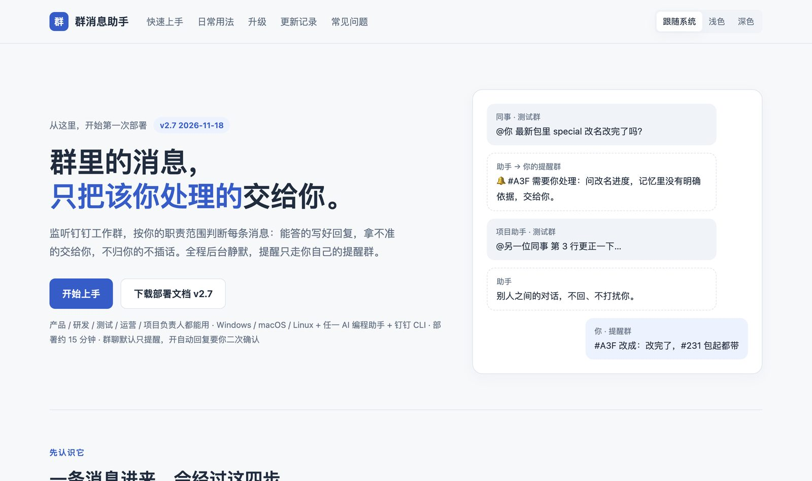
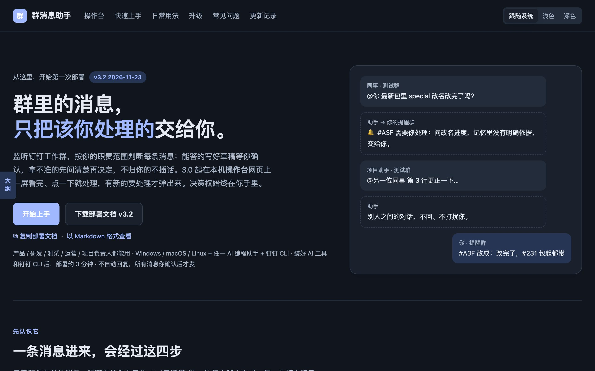

# 群消息助手（钉钉）

 

监听钉钉群消息，按你的角色和职责范围判断每一条：能答的写好回复，拿不准的交给你，不归你的不插话。后台运行，默认打开本机操作台，提醒走你自己的提醒群机器人。

- **任意 AI 编程助手**：Codex、Claude Code、DSH、WorkBuddy、Trae、Qoder 等，你平时用哪个就用哪个（账号、API Key 自己配）
- **Windows / macOS / Linux**：开机自启分别用计划任务 / LaunchAgent / systemd
- **本人确认后发送**：所有回复先写草稿，你确认后才发；绝不替你接需求、排期、承诺；别人之间的对话不插话
- **全角色**：内置角色职责库（产品、研发各端、测试、运营、后台、项目负责人），也能接你们自己的项目协作库

当前程序 **v3.1.4（3.1系列）**。公共版本只包含通用属性和规则模板，个人账号、群、时段、授权、配置、记忆、草稿和审计均留本机。

在提醒群提问后，操作台“你的消息”显示排队、处理中、已回复或失败。“机器人通知”显示完整回执与实际投递状态；独立发送脚本可调用 `console.mirror_notification` 接入，离线通知落盘补记并去重，不重发机器人消息，也不据此关闭业务任务。等待过久主动提醒，重启中断可追查；发送类指令不会自动重发。通知按结论、详情和下一步分段，保留代码与链接。任务可搜索，未发送的修改在刷新后保留，发送失败明确提示并保留草稿。

本人明确要求接口回归/复测，或确认含执行承诺的草稿后，进入持久化“执行任务”。默认保留现有值守助手，回执接口只记录实际进展，不接管执行；仅本人明确选择内置执行器时才通过本机 `execution_jobs` 绑定测试入口；没有入口明确未执行并提醒，不会只回消息就消失。操作台可查看运行编号、原始日志、定期进度与结果；进程退出0但数量或报告不完整不能计通过，中断不自动重跑。配置方式与结果协议见部署文档常见问题，个人入口不随版本发布。

## 怎么用

先在[在线指南](https://lvan826199.github.io/dingtalk-group-assistant/)下载部署文档，拖进 AI 助手说「开始」即可。也可下载对应系统安装包：Windows 双击 `install.cmd`，macOS / Linux 运行 `sh install.sh`，再把 [`docs/分享-可直接部署并运行AI监控钉钉群并自动处理.md`](docs/分享-可直接部署并运行AI监控钉钉群并自动处理.md) 拖进 AI 助手，发「配置」；AI 只帮你认人、确认角色职责、选群、绑定提醒与建记忆。

已经装过的：首次用安装包升到 v3.1，以后提醒群收到新版本通知，回「升级」即可；配置、记忆、草稿和本人规则保留，校验失败不替换。

## 实时汇报（按需打开）

默认在操作台看状态，并自动打开只读终端汇报窗口；配置 `report_window: false` 可关闭自动开窗：Windows 自动打开独立控制台（后台仍用 pythonw），macOS 打开「终端」，Linux 桌面环境打开可用终端；已有前台终端就直接在原窗口输出。Linux 无图形桌面时会明确提示，并继续写日志。

窗口先显示最近 20 条，再跟随收到消息、开始处理、忽略原因、待你决定、草稿待确认和真实发送结果。只读日志，不重复监听、不消费事件；关闭它不影响独立后台，已有自动查看器时不重复开窗。升级后重启后台即可，机器人通知偏好保留，草稿仍需本人确认后才发送；未配置时默认开启，已有的显式关闭偏好保留。

临时重开：Windows 用 `python C:\qa-agent\agent.py watch`，macOS / Linux 用 `python3 ~/qa-agent/agent.py watch`；加 `--once` 只看最近 20 条。这是排查用的备用命令。窗口不向已有的 AI 对话自动插入日志，窗口存在也不能证明每条消息已处理。

## 截图

部署文档可以一键生成成内网网页（`python3 site/build_site.py`），同事在浏览器里看步骤、复制命令、下载文档：

公开版指南：<https://lvan826199.github.io/dingtalk-group-assistant/>

| 上手步骤 + 进度勾选 | 日常用法（点指令就复制） |
|---|---|
|  |  |
| **角色职责库（可自行增删改，AI 也能补充）** | **深色模式** |
|  |  |

手机上也能看：

## 目录

| 路径 | 内容 |
|---|---|
| `docs/` | 部署文档（给 AI 助手的完整指令、代码、工作手册） |
| `agent.py` | 助手主程序 |
| `bootstrap_memory.py` | 首次建记忆（读群历史和你的 AI 对话记录） |
| `roles/角色职责库.json` | 角色职责库，可以自己增删改 |
| `site/` | 可选：把文档做成内网网页（`python3 site/build_site.py`） |
| `CHANGELOG.md` | 更新记录 |
| `ROADMAP.md` | 路线图（待验证、计划中） |
| `tests/` | 自动化测试，CI 在 Windows / macOS / Linux 上跑 |

改完程序后运行 `python3 -I build_docs.py --docs-only`，只同步仓库文档；正式站点、共享盘部署单独确认。公开版只从内部仓库经导出脚本生成，敏感扫描必须为0，测试以本公开仓库的三平台 CI 为准。

## 前提

- 钉钉 CLI（`dws`），由你自己扫码登录；本工具不代填任何凭据
- Python 3.10+、Git、Node
- 一个只有你自己的钉钉群 + 自定义机器人（加签），用来接收提醒

## 许可

[Apache-2.0](LICENSE) · 作者：梦无矶
